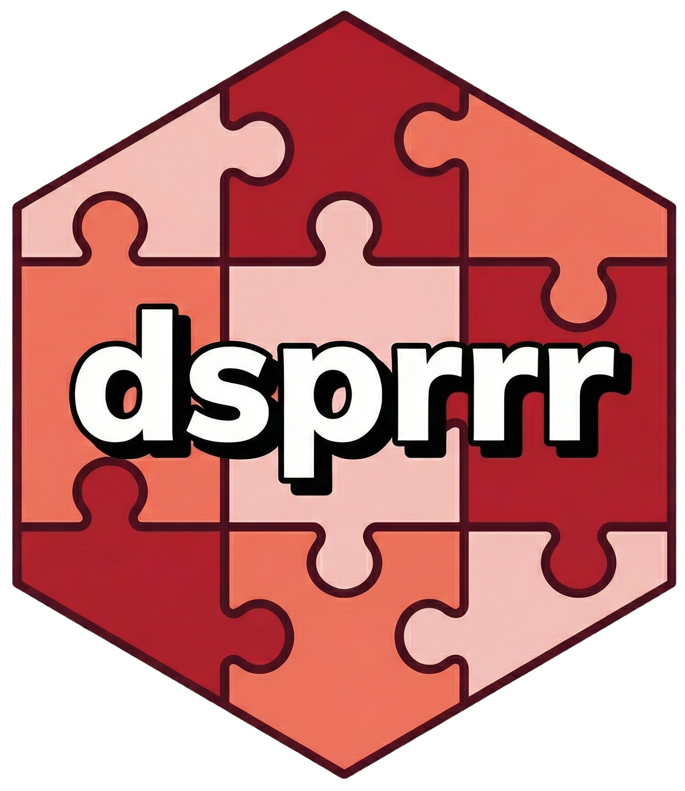

<!-- README.md is generated from README.Rmd. Please edit that file -->

```{r, include = FALSE}
knitr::opts_chunk$set(
  collapse = TRUE,
  comment = "#>",
  fig.path = "man/figures/README-",
  out.width = "100%"
)
# Attach here so the masking notices stay out of the README.
library(dsprrr)
```

# dsprrr 

<!-- badges: start -->
[](https://lifecycle.r-lib.org/articles/stages.html#experimental)
[](https://github.com/JamesHWade/dsprrr/actions/workflows/R-CMD-check.yaml)
[](https://app.codecov.io/gh/JamesHWade/dsprrr)
<!-- badges: end -->

**Program LLMs in R instead of hand-tuning prompt strings.**

A hand-written prompt mixes three fragile things into one string: *what* you
want, *how* to coax a particular model, and *which examples* to include. Tweak a
sentence or switch models, and you are back to eyeballing outputs.

`dsprrr` brings [DSPy](https://dspy.ai)'s declarative programming model to R on
top of [ellmer](https://ellmer.tidyverse.org). You declare a task's inputs and
typed outputs once, pick how the model solves it, score it on labeled data, and
let an optimizer fit the prompt's instructions and examples to your metric.

## The idea in 10 seconds

If you have ever fit a model in R, you already know how `dsprrr` works:

| Modeling in R | LLM programming in `dsprrr` |
|---|---|
| `y ~ x1 + x2` (formula) | `signature("ticket -> urgency: enum('low', 'high'), team: string")` — declares *what* goes in and comes out |
| `lm()` / `rand_forest()` | `module()`, `chain_of_thought()`, `react()`, `pipeline()` — chooses *how* to solve it |
| `yardstick` metric | `metric_exact_match()`, `metric_field_match()`, `metric_f1()`, or [vitals](https://vitals.tidyverse.org) scorers |
| `fit(spec, train)` | `compile(mod, optimizer, trainset)` — fits instructions and few-shot demos to your data |
| `predict()` / test score | `run()`, `run_dataset()`, `evaluate(mod, valset, metric)` — runs on values or data frames, scores on held-out rows |

### Why not plain ellmer?

`dsprrr` builds **on** `ellmer` — every provider `ellmer` supports (OpenAI,
Anthropic, Google, Ollama, and more) works out of the box. For a quick one-off
prompt that already works, plain `ellmer` is all you need.

`dsprrr` pays off once an LLM call is part of a repeatable workflow:

- **Swap strategies without rewriting prompts.** Keep the same `signature()` and
  switch between `module()`, `chain_of_thought()`, `react()`, `best_of_n()`, or
  multi-step `%>>%` pipelines in one line.
- **Replace guesswork with metrics.** Score every version on a data frame with
  `evaluate()`, and inspect prompts, traces, and token costs.
- **Optimize prompts with data.** `compile()` selects working few-shot examples
  or rewrites instructions to raise your metric. Switch models later? Re-compile
  on the same data instead of starting prompt engineering over.

## A quick tour

### 1. Declare the task

A `signature()` names the inputs on the left of `->` and typed outputs on the
right. `dsprrr` builds the prompt and JSON schema from it, so outputs come back
as typed R values rather than text you have to parse.

```{r signature}
library(dsprrr)

sig <- signature(
  "ticket -> urgency: enum('low', 'high'), team: enum('billing', 'technical', 'account')",
  instructions = "Route an incoming support ticket."
)
sig
```

### 2. Choose how it runs (and compose steps)

Turn the signature into a runnable module with any `ellmer` chat. Changing *how*
the model reasons — or chaining steps into a pipeline — never touches your
signature:

```r
chat <- ellmer::chat_openai(model = "gpt-6-luna")

router <- module(sig)                       # one structured call
# router <- chain_of_thought(sig)           # reason step by step first
# router <- react(sig, tools = list(lookup))# call R functions as tools

# Run on one input or across a whole data frame
run(router, ticket = "I was charged twice for my order", .llm = chat)
run_dataset(router, new_tickets, .llm = chat)

# Compose multi-step programs — pipelines are modules too
triage <- router %>>% module(signature("urgency, team -> reply"))
```

### 3. Measure on labeled data

Split your labeled data, pick a metric, and measure a baseline before changing
anything:

```r
splits <- split_dataset(tickets, prop = 0.7, seed = 1)
metric <- metric_exact_match(field = "urgency")

baseline <- evaluate(router, splits$val, metric = metric, .llm = chat)
baseline$mean_score
```

### 4. Optimize with data, then save

`compile()` runs an optimizer (a *teleprompter*) over your training rows and
returns a new compiled module — leaving `router` unchanged. Check the compiled
module on `splits$val`, then save it so production sessions do not repeat the
search:

```r
# Learn working few-shot demos (or rewrite instructions with MIPROv2() / GEPA())
optimized <- compile(
  router,
  BootstrapFewShot(
    metric = metric,
    max_bootstrapped_demos = 4L,
    max_labeled_demos = 0L
  ),
  trainset = splits$train,
  .llm = chat
)

evaluate(optimized, splits$val, metric = metric, .llm = chat)$mean_score
optimization_result(optimized)

save_program(optimized, "ticket_router.rds")
```

Want to move from OpenAI to Anthropic or a local model? Swap
`chat <- ellmer::chat_anthropic()` and re-run `compile()` on the same data.

## What's included

| Capability | Key functions |
|---|---|
| **Declare tasks** | `signature()`, `input()`, `with_instructions()`, `with_reasoning()` |
| **Reasoning & tools** | `module()`, `chain_of_thought()`, `react()`, `rag_module()`, `best_of_n()`, `refine()`, `ensemble()`, `multi_chain_comparison()`, `program_of_thought()`, `code_act()` |
| **Compose workflows** | `pipeline()`, `step()`, `%>>%`, `module_fn()`, `with_assertions()` |
| **Run & scale** | `run()`, `run_dataset()`, `run_async()`, `run_stream()`, `configure_cache()` |
| **Measure & inspect** | `evaluate()`, `metric_exact_match()`, `metric_field_match()`, `metric_f1()`, [vitals](https://vitals.tidyverse.org) bridges, `get_last_prompt()`, `inspect_history()`, `summarize_traces()`, `session_cost()` |
| **Optimize** | `compile()` with `LabeledFewShot()`, `BootstrapFewShot()`, `KNNFewShot()`, `MIPROv2()`, `GEPA()`, `COPRO()`, `SIMBA()`, `BetterTogether()`, `GridSearchTeleprompter()`, and `optimize_grid()` |
| **Save & integrate** | `save_program()`, `load_program()`, [pins](https://pins.rstudio.com) (`pin_module_config()`), [ragnar](https://ragnar.tidyverse.org) (`ragnar_tool()`), [tidymodels](https://www.tidymodels.org) (`llm_predict()`) |

**Experimental:** `rlm_module()` (a model explores a large R object by writing
code), `flex()` (GEPA rewrites a whole program), `with_decisions()` and
`ReAnchor()` (calibrated decision thresholds), `Omni()`, and agentic
optimization harnesses.

## Installation

Install `dsprrr` from CRAN:

```r
install.packages("dsprrr")
```

Or install the development version from GitHub:

```r
# install.packages("pak")
pak::pak("JamesHWade/dsprrr")
```

Set credentials for a model provider in your `.Renviron` (for example
`OPENAI_API_KEY` or `ANTHROPIC_API_KEY`), then run `dsprrr_sitrep()` to verify
your setup.

> **Note:** Installing from source requires a C compiler (Rtools on Windows,
> Xcode Command Line Tools on macOS, or your Linux distribution's build tools);
> the compiled helper preserves exact filesystem identities for safe
> persistence.

## Learn more

- **New to `dsprrr`?** Start with the six step-by-step
  [Tutorials](https://jameshwade.github.io/dsprrr/articles/tutorial-hello-world.html).
- **Want the full mental model?** Read
  [How dsprrr works](https://jameshwade.github.io/dsprrr/articles/concepts-signatures-modules.html)
  and
  [Metrics and evaluation](https://jameshwade.github.io/dsprrr/articles/concepts-why-metrics-matter.html).
- **Ready to optimize?** See
  [Compile and optimize](https://jameshwade.github.io/dsprrr/articles/compilation-optimization.html)
  and
  [Choose an optimizer](https://jameshwade.github.io/dsprrr/articles/advanced-optimization.html).
- **Coming from Python DSPy?** Read
  [dsprrr for DSPy users](https://jameshwade.github.io/dsprrr/articles/dspy-comparison.html).
- **Looking up a function?** Browse the
  [Reference](https://jameshwade.github.io/dsprrr/reference/index.html) or
  [Quick reference](https://jameshwade.github.io/dsprrr/articles/cheatsheet.html).

## Status & acknowledgments

Experimental — the API may still change. See the
[open issues](https://github.com/JamesHWade/dsprrr/issues) for ongoing work.

Built on [ellmer](https://ellmer.tidyverse.org) and
[S7](https://rconsortium.github.io/S7/). Inspired by
[DSPy](https://github.com/stanfordnlp/dspy) from Stanford NLP.
